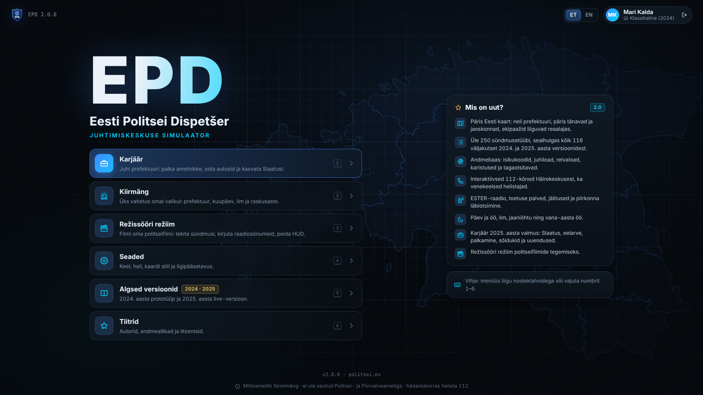
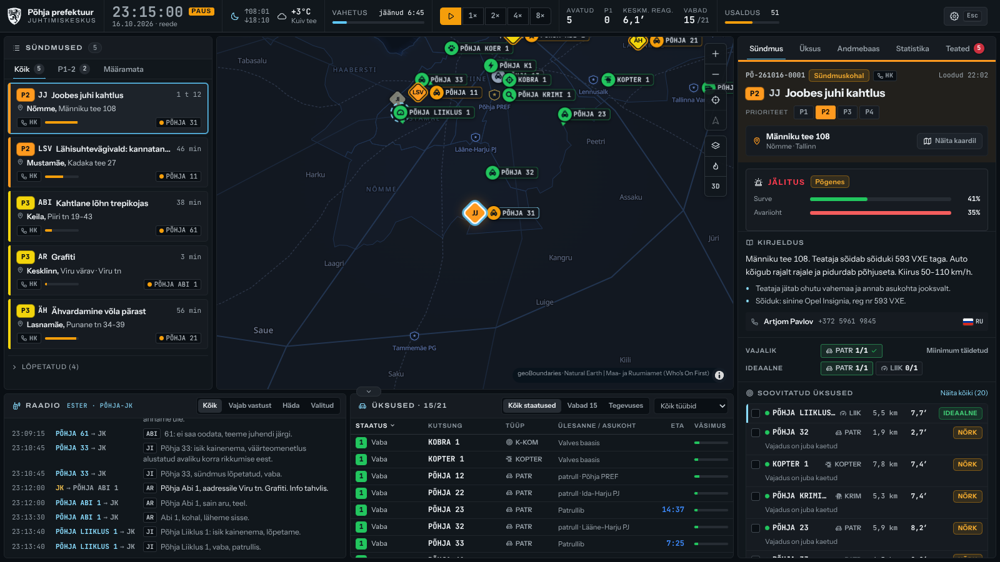
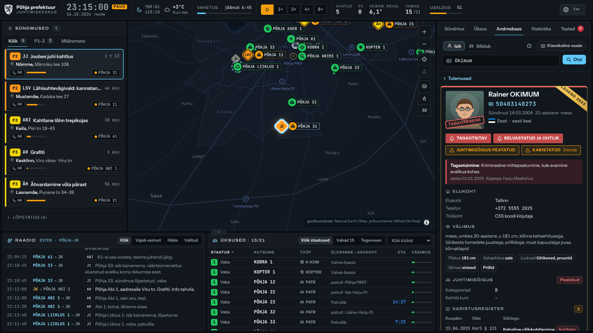
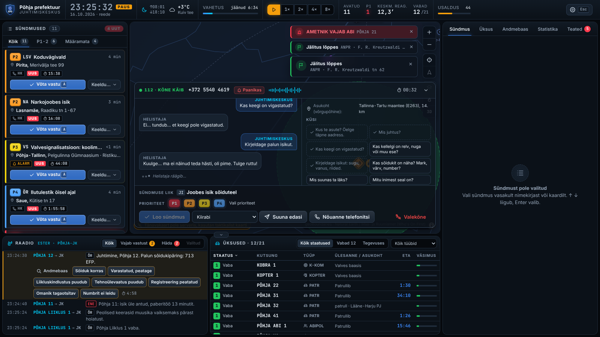
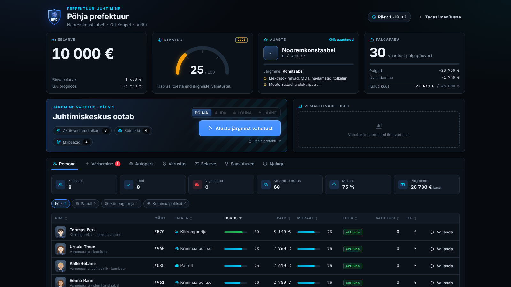
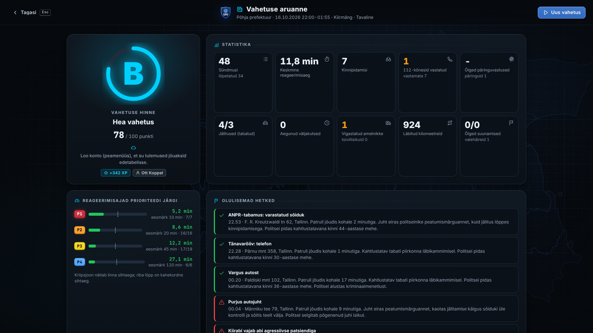

# EPD · Eesti Politsei Dispetšer

politsei.eu

**Realistlik Eesti politsei juhtimiskeskuse simulaator brauseris: võta väljakutseid vastu, saada patrullid välja ja hoia oma prefektuuris kord.**

*A realistic Estonian police dispatch simulator in your browser: take the calls, send the patrols and keep your prefecture safe.*

> [!IMPORTANT]
> **Mitteametlik fännimäng.** EPD ei ole seotud Politsei- ja Piirivalveametiga (PPA) ega ühegi teise riigiasutusega. Mäng ei esinda neid ega kasuta nende sümboolikat. Politsei ametlik veebileht on [politsei.ee](https://www.politsei.ee). Kõik mängus olevad isikud, sündmused ja registrikanded on väljamõeldud. **Hädaolukorras helista 112.**
>
> **Unofficial fan game.** EPD is not affiliated with, endorsed by or acting for the Estonian Police and Border Guard Board (PPA) or any other government agency, and it does not use their insignia. The official police website is [politsei.ee](https://www.politsei.ee). All people, incidents and records in the game are fictional. **In an emergency, call 112.**

<p align="center"><strong>Mängi / Play: <a href="https://politsei.eu">https://politsei.eu</a></strong><br>
<sub>Töötab brauseris, paigaldada pole vaja · Runs in the browser, nothing to install</sub></p>

[Eesti keeles](#eesti-keeles) · [In English](#in-english) · [Ekraanipildid / Screenshots](#ekraanipildid--screenshots)

## Ekraanipildid / Screenshots

| Peamenüü · Main menu | Juhtimiskeskus · Dispatch view |
| :---: | :---: |
|  |  |
| **Andmebaas · Registry** | **112 kõne · 112 call** |
|  |  |
| **Karjäär · Career** | **Vahetuse aruanne · Shift report** |
|  |  |

---

## Eesti keeles

### Mis see on?

Sa oled politsei juhtimiskeskuse dispetšer. Häirekeskus edastab sulle sündmusi ja sina otsustad, kes ja kui kiiresti kohale sõidab. Kontrollid inimesi ja sõidukeid andmebaasist, vastad patrullide raadiokutsetele ja hoiad silma peal kogu prefektuuril.

EPD 2.0 on 2024. ja 2025. aasta brauserimängu „Politsei Andmebaas“ täielik uusversioon. Idee on sama, kuid nüüd on mängus päris kaart, elav maailm ja põhjalik karjäärirežiim.

### Põhiomadused

- **Päris Eesti kaart.** Võrguühenduseta töötav vektorkaart (geoBoundaries, Natural Earth) ning tänavakaart mängu enda serverist (OpenStreetMap, Protomaps, ilma välise API-ta). Lisaks Maa- ja Ruumiameti hallkaart ja ortofoto. Üksused liiguvad kaardil reaalajas.
- **Neli prefektuuri:** Põhja, Ida, Lõuna ja Lääne, päris linnade, tänavate ja jaoskondadega.
- **260 sündmusetüüpi**, nende hulgas kõik 116 väljakutset algsetest versioonidest. Kohapeal tuleb teha otsuseid, saata toetust, kutsuda kiirabi, toimetada kinnipeetuid arestimajja, juhtida jälitusi ja otsinguid.
- **Andmebaas**, austusavaldus algsele „Politsei Andmebaasile“. Isikutel on kehtiv isikukood, aadress, juhiluba, relvaluba ja karistusregistri kanded, mis viitavad Eesti seaduste paragrahvidele. Sõidukitel on numbrimärk, VIN-kood, kindlustus, tehnoülevaatus ja vajaduse korral tagaotsimise märge.
- **Interaktiivsed 112 kõned.** Häirekeskus ühendab helistaja sinuga: esita küsimusi, hinda olukorda ja määra prioriteet. Ida-Virumaal helistavad ka venekeelsed inimesed, appi saab võtta tõlgi. Ära tunda tuleb ka pahatahtlikud kõned.
- **Raadioside** TETRA-võrgu (ESTER) stiilis: üksused annavad teada, küsivad ja ootavad vastust. Raadio- ja telefonihelid sünteesitakse protseduuriliselt (Web Audio), helifaile ei ole.
- **Elav maailm:** päev ja öö (päris päikesetõus ja -loojang), aastaajad, ilm ning pühad, näiteks jaanipäev ja aastavahetus.
- **Karjäär**, mis põhineb 2025. aasta versioonil: Staatus, eelarve, ametnike palkamine, autopark, uuendused (kehakaamerad, elektrišokirelvad, ANPR, droonid, K9, helikopteritunnid), auastmed ja saavutused.
- **Ajalehe esikülg** pärast iga vahetust, lisaks hinne ja aruanne.
- **Režissööri režiim** politseifilmide filmimiseks: tekita mis tahes sündmus ükskõik kuhu, kirjuta oma raadiolaused, peida kasutajaliides ja kasuta reaalajas kella.
- **Töötab võrguühenduseta:** mängu saab paigaldada veebirakendusena (PWA).
- **Eesti ja inglise keel.**

### Kuidas mängida

1. Vali menüüst **Karjäär**, **Kiirmäng** või **Režissööri režiim**, seejärel prefektuur ja vahetus (päev või öö; 4, 8 või 12 tundi).
2. Uus sündmus ilmub järjekorda vilkuva kaardina. Kinnita see kiiresti (<kbd>A</kbd>), muidu langeb inimeste usaldus. Väljakutse, mis politseid ei vaja, võid suunata teisele asutusele, lahendada telefoni teel või märkida pahatahtlikuks.
3. Saada välja sobivad üksused. <kbd>D</kbd> saadab soovitatud üksuse: lähima ja sündmusele kõige sobivama.
4. Jälgi kaarti ja raadiot. Kui patrull palub isikut või sõidukit kontrollida, otsi see **Andmebaasist** (<kbd>F3</kbd>) üles ja vasta. Kui keegi vajab toetust, saada abi enne, kui aeg otsa saab.
5. Vahetuse lõpus saad hinde, aruande ja homse ajalehe esikülje. Karjäärirežiimis lähevad eelarve ja Staatus järgmisse päeva kaasa: palka inimesi juurde, osta autosid ja varustust.

#### Kiirklahvid

| Klahv | Tegevus |
| --- | --- |
| <kbd>Space</kbd> | Paus / jätka |
| <kbd>1</kbd>-<kbd>5</kbd> | Mängu kiirus |
| <kbd>A</kbd> | Kinnita valitud sündmus |
| <kbd>D</kbd> | Saada soovitatud üksus |
| <kbd>F2</kbd> | Sündmuste järjekord |
| <kbd>F3</kbd> | Andmebaas |
| <kbd>F4</kbd> | Üksused |
| <kbd>F6</kbd> | Raadioside |
| <kbd>H</kbd> | Peida või näita kasutajaliidest (filmimiseks) |
| <kbd>Esc</kbd> | Sulge aken |

### Algsed versioonid

EPD sai alguse 2024. aasta septembris lihtsa HTML-mänguna. Mõlemad algsed versioonid on alles ja mängitavad nii menüüst („Algsed versioonid“) kui ka otse:

- [2024. aasta prototüüp](https://politsei.eu/legacy/politseimang-2024.html): `/legacy/politseimang-2024.html`
- [2025. aasta versioon](https://politsei.eu/legacy/politseimang-2025.html): `/legacy/politseimang-2025.html`

Muudatuste ajalugu on failis [CHANGELOG.md](CHANGELOG.md).

### Arendus

Vaja on **Node.js 22** ja npm-i.

```bash
git clone https://github.com/Qupkene/Estonian-Police-Dispatch.git
cd Estonian-Police-Dispatch
npm ci              # paigalda sõltuvused
npm run dev         # arendusserver: http://localhost:5173
npm test            # ühiktestid (Vitest)
npm run typecheck   # TypeScripti kontroll
npm run build       # tootmisversioon kausta dist/
npm run preview     # ehitatud versiooni eelvaade: http://localhost:4173
```

E2E-testid (Playwright) käivitavad ise `npm run preview` serveri, seega tuleb mäng enne ehitada:

```bash
npx playwright install chromium   # ainult esimesel korral
npm run build
npm run e2e
```

GitHub Actions kontrollib iga push'i ja pull request'i (`.github/workflows/ci.yml`). Kui CI on `main` harul roheline, uuendab koduserver politsei.eu ise (GitHubi webhook, vaata allpool „Paigaldus“). Avaldamise juhend on failis [docs/DEPLOY.md](docs/DEPLOY.md), mängudisain ja arhitektuur failis [docs/DESIGN.md](docs/DESIGN.md).

### Projekti struktuur

```
src/
  app/        rakenduse kest ja ekraanide vahetamine
  sim/        simulatsioonimootor: puhas TypeScript, ilma DOM-i ja Reactita
  gen/        protseduurilised generaatorid: isikukoodid, nimed, aadressid, sõidukid, portreed
  data/       geoandmed, prefektuurid, sündmuste mallid, seadused, majandus
  map/        MapLibre kaart, kaardistiilid ja markerid
  audio/      sünteesitud helid ja kõnesüntees
  store/      zustandi olekud: mäng, seaded, karjäär
  i18n/       eesti- ja ingliskeelsed tekstid
  ui/         ekraanid, mänguvaade, Andmebaas, 112 kõned, režissööri paneel
  pwa.ts      service workeri registreerimine
tests/        Vitesti ühiktestid
e2e/          Playwrighti suitsutestid
docs/         disain, avaldamine, taustauuringud, algsed väljakutsed
public/       staatilised failid: kaardi fondid, algsed versioonid, PWA failid
server/       PHP API: kontod, pilvesalvestus, edetabel, uuenduse webhook
deploy/       koduserveri ja relee paigaldusskriptid
```

### Tehnoloogia

- **Vite 8**, **React 19**, **TypeScript 7** (strict)
- **zustand 5** oleku haldamiseks
- **MapLibre GL JS 6** kaardiks, oma vektorstiil ja kohalikud fondiglüüfid
- **Web Audio API** helideks, käsitsi kirjutatud **SVG** graafikuteks ja portreedeks
- **Vitest** ja **Playwright** testimiseks
- Fondid: Inter ja JetBrains Mono (Fontsource), kaardil Noto Sans
- Majutus: autori koduserver (**FrankenPHP** konteiner, **PHP 8.4**, **SQLite**) relee VPS-i ja **WireGuardi** taga, CI **GitHub Actions**

### Andmeallikad ja litsentsid

| Allikas | Milleks | Litsents |
| --- | --- | --- |
| [geoBoundaries](https://www.geoboundaries.org) | maakondade ja asustusüksuste piirid, asulad | CC BY 4.0 |
| [Natural Earth](https://www.naturalearthdata.com) | maismaa, järved, maanteed, raudteed | avalik omand (public domain) |
| © [OpenStreetMap](https://www.openstreetmap.org/copyright)'i kaastöötajad, [Protomaps](https://protomaps.com) | tänavakaart (PMTiles, mängu serverist) | OSM-i andmed ODbL, stiil BSD-3-Clause |
| [Maa- ja Ruumiamet](https://maaruum.ee) | võrgus hallkaart ja ortofoto | Maa- ja Ruumiameti avaandmete tingimused, viitega allikale |
| Noto Sans, Inter, JetBrains Mono | fondid | SIL Open Font License 1.1 |
| [MapLibre GL JS](https://maplibre.org) | kaardimootor | BSD-3-Clause |

Isikukoodid, numbrimärgid ja registrikanded genereeritakse juhuslikult. Kui mõni neist langeb kokku päris inimese või sõidukiga, on see juhus.

### Tegijad

- **Algne idee ning 2024. ja 2025. aasta versioonid:** qupkene ja 0kimum. Kui sul on küsimusi, kirjuta meile Discordis: **qupkene**, **0kimum**.
- **EPD 2.0** (2026) on algse idee põhjal tehtud uusversioon.

### Tulevik

Unistus on endiselt sama: täismäng Steamis või mõnel teisel platvormil.

### Litsents

Litsents: veel valimata (all rights reserved by the authors until a license is chosen). Kolmandate osapoolte andmetele, fontidele ja teekidele kehtivad nende endi litsentsid (vt ülal).

---

## In English

### What is it?

You are the dispatcher at a police command centre. The Emergency Response Centre (Häirekeskus) passes incidents to you, and you decide who goes and how fast. You look people and vehicles up in the registry, answer radio calls from your patrols and keep an eye on the whole prefecture.

EPD 2.0 is a complete remake of the 2024 and 2025 browser game "Politsei Andmebaas". The idea is the same, but the game now has a real map, a living world and a full career mode.

### Features

- **A real map of Estonia.** An offline vector map (geoBoundaries, Natural Earth), plus a street map served by the game's own server (OpenStreetMap, Protomaps, no third-party API) and the Maa- ja Ruumiamet grey map and orthophotos. Units drive on the map in real time.
- **Four prefectures:** Põhja (North), Ida (East), Lõuna (South) and Lääne (West), with real towns, streets and police stations.
- **260 incident types**, including all 116 calls from the original versions. On scene you make decisions, send backup, call an ambulance, take detainees to the arrest house, and run pursuits and area searches.
- **The registry (Andmebaas)**, a homage to the original "Politsei Andmebaas". People have valid Estonian personal ID codes (isikukood), addresses, driving licences, weapon permits and criminal records that cite real paragraphs of Estonian law. Vehicles have plates, VINs, insurance, roadworthiness tests and, sometimes, a stolen flag.
- **Interactive 112 transfers.** The Emergency Response Centre puts the caller through to you: ask questions, assess the situation and set the priority. In Ida-Virumaa some callers speak Russian, and you can bring in an interpreter. You also have to spot prank calls.
- **TETRA-style radio** modelled on Estonia's ESTER network: units report in, ask questions and wait for your reply. Radio and phone sounds are synthesised procedurally (Web Audio), with no audio files.
- **A living world:** day and night (real sunrise and sunset times), seasons, weather and holidays such as Midsummer (jaanipäev) and New Year.
- **Career mode**, built on the 2025 version: reputation (Staatus), budget, hiring officers, a vehicle fleet, upgrades (body cameras, tasers, ANPR, drones, K9, helicopter hours), ranks and achievements.
- **A newspaper front page** after every shift, along with your grade and shift report.
- **Director mode (Režissööri režiim)** for filming police movies: spawn any incident anywhere, write your own radio lines, hide the interface and run a real-time clock.
- **Works offline:** install it as a web app (PWA).
- **Estonian and English.**

### How to play

1. From the menu pick **Career**, **Quick game** or **Director mode**, then a prefecture and a shift (day or night; 4, 8 or 12 hours).
2. A new incident appears in the queue as a blinking card. Acknowledge it quickly (<kbd>A</kbd>) or public trust drops. Calls that do not need the police can be referred to another agency, handled with phone advice or marked as pranks.
3. Send suitable units. <kbd>D</kbd> dispatches the recommended unit: the closest one that best fits the incident.
4. Watch the map and the radio. When a patrol asks you to check a person or a vehicle, look it up in the **registry** (<kbd>F3</kbd>) and answer. When someone needs backup, send help before the timer runs out.
5. At the end of the shift you get a grade, a report and tomorrow's front page. In career mode your budget and reputation carry over to the next day, so you can hire more officers and buy vehicles and equipment.

#### Hotkeys

| Key | Action |
| --- | --- |
| <kbd>Space</kbd> | Pause / resume |
| <kbd>1</kbd>-<kbd>5</kbd> | Game speed |
| <kbd>A</kbd> | Acknowledge the selected incident |
| <kbd>D</kbd> | Dispatch the recommended unit |
| <kbd>F2</kbd> | Incident queue |
| <kbd>F3</kbd> | Registry (Andmebaas) |
| <kbd>F4</kbd> | Units |
| <kbd>F6</kbd> | Radio |
| <kbd>H</kbd> | Hide or show the interface (for filming) |
| <kbd>Esc</kbd> | Close the current window |

### Original versions

EPD started in September 2024 as a simple HTML game. Both original versions are preserved and playable from the menu ("Algsed versioonid") or directly:

- [2024 prototype](https://politsei.eu/legacy/politseimang-2024.html): `/legacy/politseimang-2024.html`
- [2025 version](https://politsei.eu/legacy/politseimang-2025.html): `/legacy/politseimang-2025.html`

See [CHANGELOG.md](CHANGELOG.md) for the history.

### Development

You need **Node.js 22** and npm.

```bash
git clone https://github.com/Qupkene/Estonian-Police-Dispatch.git
cd Estonian-Police-Dispatch
npm ci              # install dependencies
npm run dev         # dev server: http://localhost:5173
npm test            # unit tests (Vitest)
npm run typecheck   # TypeScript check
npm run build       # production build into dist/
npm run preview     # preview the build: http://localhost:4173
```

The end-to-end tests (Playwright) start `npm run preview` themselves, so build first:

```bash
npx playwright install chromium   # first time only
npm run build
npm run e2e
```

GitHub Actions checks every push and pull request (`.github/workflows/ci.yml`). When CI is green on `main`, the home server updates politsei.eu by itself (GitHub webhook, see "Deploy" below). See [docs/DEPLOY.md](docs/DEPLOY.md) for the deployment guide and [docs/DESIGN.md](docs/DESIGN.md) for the game design and architecture.

### Project structure

```
src/
  app/        app shell and screen router
  sim/        simulation engine: pure TypeScript, no DOM or React
  gen/        procedural generators: ID codes, names, addresses, vehicles, portraits
  data/       geodata, prefectures, incident templates, laws, economy
  map/        MapLibre map, map styles and markers
  audio/      synthesised sound effects and speech
  store/      zustand stores: game, settings, career
  i18n/       Estonian and English UI strings
  ui/         screens, game view, registry, 112 calls, director panel
  pwa.ts      service worker registration
tests/        Vitest unit tests
e2e/          Playwright smoke tests
docs/         design, deployment, research notes, original call list
public/       static files: map glyphs, original versions, PWA files
server/       PHP API: accounts, cloud saves, leaderboard, update webhook
deploy/       home server and relay setup scripts
```

### Tech stack

- **Vite 8**, **React 19**, **TypeScript 7** (strict)
- **zustand 5** for state
- **MapLibre GL JS 6** for the map, with a custom vector style and locally served glyphs
- **Web Audio API** for sound, hand-written **SVG** for charts and portraits
- **Vitest** and **Playwright** for tests
- Fonts: Inter and JetBrains Mono (Fontsource), Noto Sans on the map
- Hosting: the author's home server (**FrankenPHP** container, **PHP 8.4**, **SQLite**) behind a relay VPS over **WireGuard**, CI on **GitHub Actions**

### Data sources and licences

| Source | Used for | Licence |
| --- | --- | --- |
| [geoBoundaries](https://www.geoboundaries.org) | county and settlement boundaries, settlements | CC BY 4.0 |
| [Natural Earth](https://www.naturalearthdata.com) | land, lakes, roads, railways | public domain |
| © [OpenStreetMap](https://www.openstreetmap.org/copyright) contributors, [Protomaps](https://protomaps.com) | street map (PMTiles from the game server) | OSM data under ODbL, style under BSD-3-Clause |
| [Maa- ja Ruumiamet](https://maaruum.ee) (Estonian Land and Spatial Development Board) | online grey-scale map and orthophoto tiles | Maa- ja Ruumiamet open-data terms, with attribution |
| Noto Sans, Inter, JetBrains Mono | fonts | SIL Open Font License 1.1 |
| [MapLibre GL JS](https://maplibre.org) | map engine | BSD-3-Clause |

ID codes, plates and records are generated at random. Any match with a real person or vehicle is a coincidence.

### Credits

- **Original idea and the 2024 and 2025 versions:** qupkene and 0kimum. If you have any questions, our Discords are **qupkene** and **0kimum**.
- **EPD 2.0** (2026) is a remake built on the original idea.

### What's next

The dream hasn't changed: a full version of the game on Steam or another platform.

### Licence

Litsents: veel valimata (all rights reserved by the authors until a license is chosen). Third-party data, fonts and libraries remain under their own licences (see above).

## Paigaldus / Deploy

**Eesti keeles.** politsei.eu jookseb autori koduserveris (MainServer): ehitatud mäng ja väike PHP API (kontod, pilvesalvestus, edetabel) FrankenPHP konteineris ning isehostitud Eesti tänavakaart (PMTiles). Avalik nägu on relee VPS, mille Caddy saadab liikluse WireGuardi kaudu koju. Paigaldus käib ühe käsuga (`sudo bash deploy/mainserver/paigalda.sh`). Iga roheline CI `main` harul jõuab saidile ise (GitHubi webhook ja 10 minuti taimer), vea korral võetakse eelmine versioon automaatselt tagasi. Juhend on failis [docs/DEPLOY.md](docs/DEPLOY.md), skriptid kaustas [deploy/](deploy/) ja serveri liides failis [docs/SERVER.md](docs/SERVER.md). GitHub Pages on alles ainult käsitsi käivitatava eelvaatena.

**In English.** politsei.eu runs on the author's home server: the built game and a small PHP API (accounts, cloud saves, leaderboard) in a FrankenPHP container, plus a self-hosted Estonian street map (PMTiles). A relay VPS is the public face; its Caddy forwards traffic home over WireGuard. Setup is one command (`sudo bash deploy/mainserver/paigalda.sh`). Every green CI run on `main` deploys itself (GitHub webhook plus a 10-minute timer), with automatic rollback when a deploy fails. The guide (in Estonian) is [docs/DEPLOY.md](docs/DEPLOY.md), the scripts are in [deploy/](deploy/) and the server contract is [docs/SERVER.md](docs/SERVER.md). GitHub Pages remains only as a manually triggered preview.
