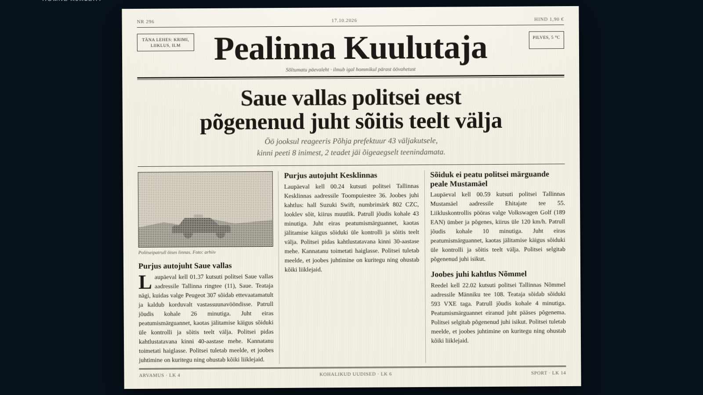
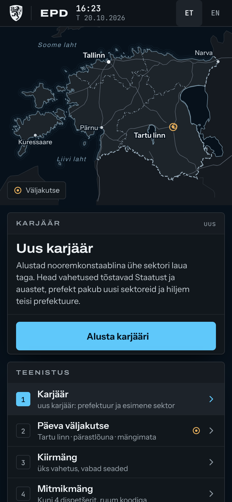
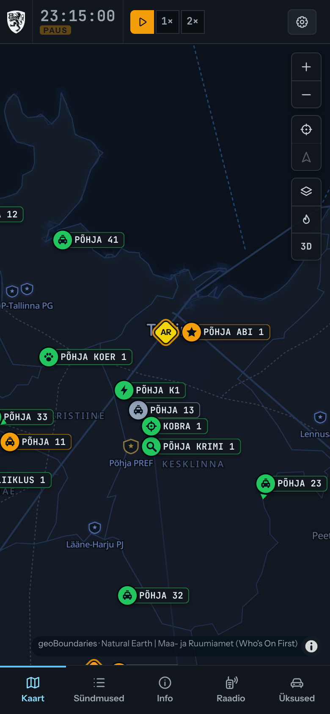
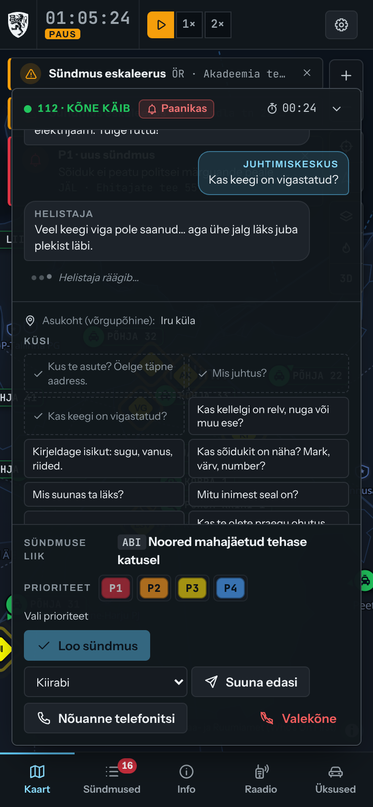

# EPD · Eesti Politsei Dispetšer

**Politsei mäng brauseris: ole Eesti politsei juhtimiskeskuse dispetšer, võta vastu 112-kõned, saada patrullid välja ja hoia oma prefektuuris kord. Tasuta, eesti keeles, üksi või sõpradega.**

*A police dispatch game in your browser: answer 112 calls, send the patrols and keep your Estonian prefecture safe. Free, in Estonian and English, alone or with friends.*

<p align="center"><strong>Mängi / Play: <a href="https://politsei.eu">politsei.eu</a></strong><br>
<sub>Töötab brauseris arvutis ja telefonis, paigaldada pole vaja · Runs in the browser on computers and phones, nothing to install</sub></p>

<p align="center">
<a href="https://politsei.eu/politseimang/">Mängust</a> ·
<a href="https://politsei.eu/juhend/">Juhend</a> ·
<a href="https://politsei.eu/mitmikmang/">Mitmikmäng</a> ·
<a href="https://politsei.eu/en/">English</a> ·
<a href="CHANGELOG.md">Muudatused</a>
</p>


> [!IMPORTANT]
> **Mitteametlik ja tasuta fännimäng, mis ei teeni tulu.** EPD ei ole Politsei- ja Piirivalveameti (PPA) ega ühegi teise riigiasutuse toode ega nendega seotud. PPA, SK ID Solutionsi (Smart-ID, Mobiil-ID) ja RIA (ID-kaart, DigiDoc) logosid kasutatakse omanike loal ([docs/PERMISSIONS.md](docs/PERMISSIONS.md)). Kõik mängu isikud, sündmused ja registrikanded on väljamõeldud. Politsei ametlik leht on [politsei.ee](https://www.politsei.ee). **Hädaolukorras helista 112.**
>
> **An unofficial, free fan game that earns no money.** EPD is not a product of, or affiliated with, the Estonian Police and Border Guard Board (PPA) or any other agency. Logos are used with their owners' permission. All people, incidents and records are fictional. **In an emergency, call 112.**

[Eesti keeles](#eesti-keeles) · [In English](#in-english) · [Arendus / Development](#arendus--development)

## Pildid / Screenshots

| Peamenüü · Main menu | 112-kõne · 112 call |
| :---: | :---: |
|  |  |
| **Andmebaas · Registry** | **Karjäär · Career** |
|  |  |
| **Vahetuse aruanne · Shift report** | **Ajalehe esikülg · Front page** |
|  |  |

| Telefonis · On a phone | | |
| :---: | :---: | :---: |
|  |  |  |

---

## Eesti keeles

### Mis mäng see on?

Sa oled politsei juhtimiskeskuse dispetšer. Häirekeskus ühendab sinuga helistajad, sina otsustad, kui kiiresti abi vaja on ja kes kohale sõidab. Kontrollid inimesi ja sõidukeid andmebaasist, vastad patrullide raadiokutsetele ja hoiad silma peal kogu sektoril või prefektuuril.

EPD sai alguse 2024. aastal lihtsa brauserimänguna „Politsei Andmebaas“. EPD 2.0 on selle täielik uusversioon: päris kaart, elav maailm, karjäär ja mitmikmäng.

### Mida mängus on

- **Päris Eesti kaart:** neli prefektuuri (Põhja, Ida, Lõuna, Lääne) päris linnade, tänavate ja jaoskondadega. Patrullid sõidavad mööda päris teid, sündmused toimuvad päris majade juures.
- **Üle 400 sündmusetüübi:** liiklusõnnetused, perevägivald, vargused, joobes juhid, kadunud inimesed, häiresignaalid, piiriintsidendid ja palju muud, sealhulgas kõik algsete versioonide väljakutsed.
- **112-kõned:** küsi, kus helistaja on ja mis juhtus, hinda olukorda ja vali prioriteet. Ida-Virumaal helistatakse ka vene keeles ja appi saab võtta tõlgi. Ära tunda tuleb ka pahatahtlikud kõned.
- **Andmebaas:** isikutel on isikukood, aadress, juhiluba, relvaluba ja karistusregistri kanded Eesti seaduste paragrahvidega, sõidukitel numbrimärk, VIN, kindlustus, ülevaatus ja vajadusel tagaotsimine.
- **Raadio eesti keeles:** patrullid räägivad sinuga ESTER-i stiilis raadios, hääl on eestikeelne kõnesüntees (TartuNLP Neurokõne).
- **Karjäär:** alusta oma sektori laua taga ja jõua prefektuuri juhiks. Viis peatükki, korduvad tegelased, eelarve, Staatus, töötajad, autopark, uuendused, auastmed ja saavutused. Naabersektorites töötavad AI kolleegid, kes paluvad abi, võtavad jälitusi üle ja katavad öid.
- **Päeva väljakutse:** kõigil on sama vahetus ja sama päeva edetabel.
- **Mitmikmäng kuni neljale:** võistlus samal vahetusel, ühine vahetus rollidega (kõnevastuvõtja, dispetšer, raadio ja registrid) või sektoritega, kus naabrid laenavad üksteisele ekipaaže. Ühine vahetus jookseb mänguserveris, nupuvajutus jõuab kohale umbes kümnendiku sekundiga.
- **Elav maailm:** päev ja öö päris päikesetõusu ja -loojanguga, aastaajad, ilm ja pühad.
- **Aruanne ja ajaleht** iga vahetuse lõpus, koos hinde ja statistikaga.
- **Režissööri režiim** politseifilmide jaoks: tekita sündmusi, kirjuta raadiolauseid ja peida kasutajaliides.
- **Kontod ja pilvesalvestus** (ID-kaardi, Mobiil-ID ja Smart-ID moodi sisselogimine on simulatsioon, päris andmeid ei küsita) või külalisena ilma kontota.
- **Töötab ka võrguta** veebirakendusena (PWA). **Eesti ja inglise keel.**

### Kuidas mängida

1. Vali menüüst **Karjäär**, **Päeva väljakutse**, **Kiirmäng** või **Mitmikmäng**.
2. Kui telefon heliseb, vasta. Küsi õiged küsimused, vali prioriteet ja loo sündmus.
3. Võta sündmus vastu (<kbd>A</kbd>) ja saada sobiv ekipaaž (<kbd>D</kbd> saadab soovitatud üksuse).
4. Jälgi kaarti ja raadiot. Kui patrull palub kedagi kontrollida, otsi ta **Andmebaasist** (<kbd>F3</kbd>) ja vasta.
5. Vahetuse lõpus saad hinde, aruande ja ajalehe esikülje.

Põhjalikum juhend: [politsei.eu/juhend](https://politsei.eu/juhend/).

| Klahv | Tegevus |
| --- | --- |
| <kbd>Space</kbd> | Paus / jätka |
| <kbd>1</kbd>-<kbd>5</kbd> | Mängu kiirus |
| <kbd>A</kbd> | Võta valitud sündmus vastu |
| <kbd>D</kbd> | Saada soovitatud üksus |
| <kbd>F2</kbd> · <kbd>F3</kbd> · <kbd>F4</kbd> · <kbd>F6</kbd> | Sündmused · Andmebaas · Üksused · Raadio |
| <kbd>H</kbd> | Peida või näita kasutajaliidest |
| <kbd>Esc</kbd> | Sulge aken |

### Algsed versioonid

Mõlemad algsed versioonid on alles ja mängitavad nii menüüst („Algsed versioonid“) kui ka otse: [2024. aasta prototüüp](https://politsei.eu/legacy/politseimang-2024.html) ja [2025. aasta versioon](https://politsei.eu/legacy/politseimang-2025.html).

---

## In English

### What is it?

You are the dispatcher at a police command centre in Estonia. The Emergency Response Centre puts the callers through to you; you decide how urgent each call is and who goes. You check people and vehicles in the registry, answer your patrols on the radio and keep an eye on your sector or the whole prefecture.

EPD started in 2024 as a small browser game, "Politsei Andmebaas". EPD 2.0 is a complete remake with a real map, a living world, a career and multiplayer.

### Features

- **A real map of Estonia** with four police prefectures, real towns, roads and stations; patrols drive on real roads and incidents happen at real buildings.
- **Over 400 incident types**, including every call from the original versions.
- **Interactive 112 calls:** ask questions, set the priority, bring in an interpreter for Russian-speaking callers, spot hoaxes.
- **The registry:** people with personal ID codes, addresses, licences, permits and criminal records citing real Estonian law; vehicles with plates, VINs, insurance, inspections and stolen flags.
- **Radio in Estonian** with a neural Estonian voice (TartuNLP).
- **Career** in five chapters with a recurring cast: from your own sector desk to running a prefecture, with budget, reputation, staff, fleet, upgrades and ranks. AI colleagues run the neighbouring sectors.
- **Daily challenge** with a shared leaderboard.
- **Multiplayer for up to four:** a race on the same shift, or one shared shift split by roles or by sectors. Shared shifts run on the game server, so a click takes effect in about a tenth of a second.
- **Day and night, seasons, weather and holidays;** a report and a newspaper front page after every shift; a director mode for filming.
- **Accounts with cloud saves** (the ID card, Mobile-ID and Smart-ID login is a simulation, no real data is asked) or play as a guest.
- **Works offline** as a web app (PWA). **Estonian and English.**

How to play: [politsei.eu/en](https://politsei.eu/en/). The hotkeys are in the table above.

---

## Arendus / Development

Vaja on / you need **Node.js 22** and npm; for the API and the multiplayer tests also **PHP 8.4** with SQLite.

```bash
git clone https://github.com/Qupkene/Estonian-Police-Dispatch.git
cd Estonian-Police-Dispatch
npm ci
npm run dev         # http://localhost:5173
npm run dev:api     # PHP API (accounts, saves, rooms) on :8787, optional
npm run dev:mp      # game server for shared shifts on :8790, optional
npm test            # Vitest
npm run typecheck
npm run build       # dist/ and dist-mp/mp.mjs
npx playwright install chromium && npm run e2e   # after a build; starts preview, PHP and the game server itself
```

Iga muudatus, mis jõuab mängijateni, tõstab versiooni ([CLAUDE.md](CLAUDE.md), [CHANGELOG.md](CHANGELOG.md)). Every change that reaches players bumps the version; CI checks it.

```
src/
  sim/        simulation engine: pure TypeScript, no DOM (also runs on the game server)
  data/       geodata, prefectures, sectors, incident templates, laws, story
  gen/        procedural people, addresses, vehicles, portraits
  map/        MapLibre map, styles, road routing
  ui/         shell screens (menu, career, lobby, report) and the in-game dispatch view
  store/      zustand stores: game, career, settings, co-op session
  net/        API clients: accounts, saves, rooms, game server
  audio/ i18n/ app/
server/
  api/ lib/   PHP API: accounts, cloud saves, leaderboards, daily challenge, rooms, tickets, speech
  mp/         Node game server (WebSocket) for shared co-op shifts
deploy/       home server and relay setup and auto-update scripts
docs/         design, multiplayer, server, SEO, deployment, sectors, story
scripts/      map data, landing pages, version check
tests/ e2e/   Vitest and Playwright
```

**Tehnoloogia / Stack:** Vite 8, React 19, TypeScript 7 (strict), zustand 5, MapLibre GL JS 6, Web Audio, Vitest, Playwright. Fonts: Archivo, Instrument Sans, Inter, JetBrains Mono (Fontsource), Noto Sans on the map. Hosting: the author's home server (FrankenPHP and PHP 8.4 with SQLite, a Node game server) behind a relay VPS over WireGuard; every green CI run on `main` deploys itself with automatic rollback ([docs/DEPLOY.md](docs/DEPLOY.md), [docs/SERVER.md](docs/SERVER.md), [docs/MULTIPLAYER.md](docs/MULTIPLAYER.md)).

### Andmeallikad ja litsentsid / Data sources and licences

| Allikas / Source | Milleks / Used for | Litsents / Licence |
| --- | --- | --- |
| [geoBoundaries](https://www.geoboundaries.org) | asulad ja piirid / settlements and boundaries | CC BY 4.0 |
| [Natural Earth](https://www.naturalearthdata.com) | maismaa, järved, teed / land, lakes, roads | public domain |
| © [OpenStreetMap](https://www.openstreetmap.org/copyright), [Protomaps](https://protomaps.com) | tänavakaart / street map (PMTiles, self-hosted) | ODbL, style BSD-3-Clause |
| [Maa- ja Ruumiamet](https://maaruum.ee) | hallkaart, ortofoto, maakonnad / grey map, orthophoto, counties | open-data terms with attribution |
| [TartuNLP Neurokõne](https://neurokone.ee) | raadio hääl / radio voice | per the service's terms |
| Archivo, Instrument Sans, Inter, JetBrains Mono, Noto Sans | fondid / fonts | SIL Open Font License 1.1 |
| [MapLibre GL JS](https://maplibre.org) | kaardimootor / map engine | BSD-3-Clause |

Isikukoodid, numbrimärgid ja registrikanded on juhuslikud; kokkulangevus päris inimese või sõidukiga on juhus. ID codes, plates and records are random; any match with a real person or vehicle is a coincidence.

### Tegijad / Credits

- **Algne idee ning 2024. ja 2025. aasta versioonid / Original idea and the 2024 and 2025 versions:** qupkene ja 0kimum (Discord: **qupkene**, **0kimum**).
- **EPD 2.0** (2026): uusversioon algse idee põhjal / a remake built on the original idea.
- Kontakt / Contact: [info@politsei.eu](mailto:info@politsei.eu)

Litsents: veel valimata, kõik õigused autoritel. Licence not chosen yet: all rights reserved by the authors. Third-party data, fonts and libraries remain under their own licences.
